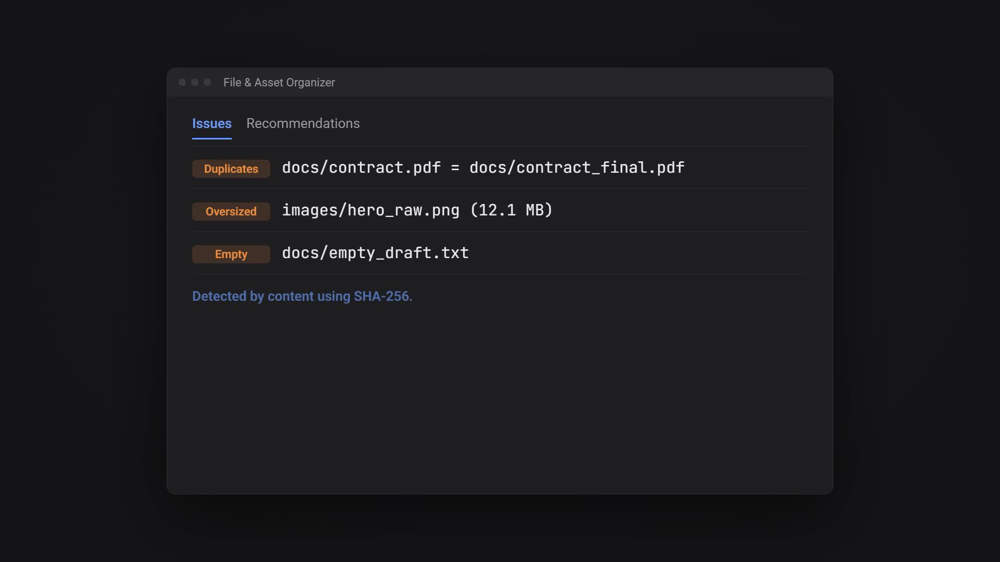
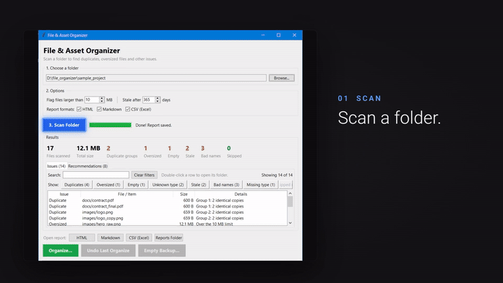
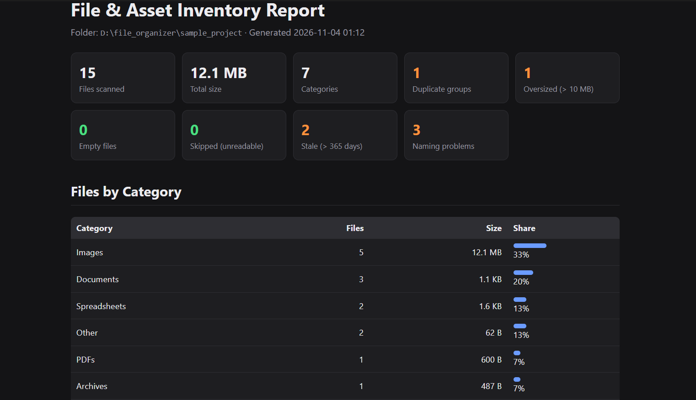
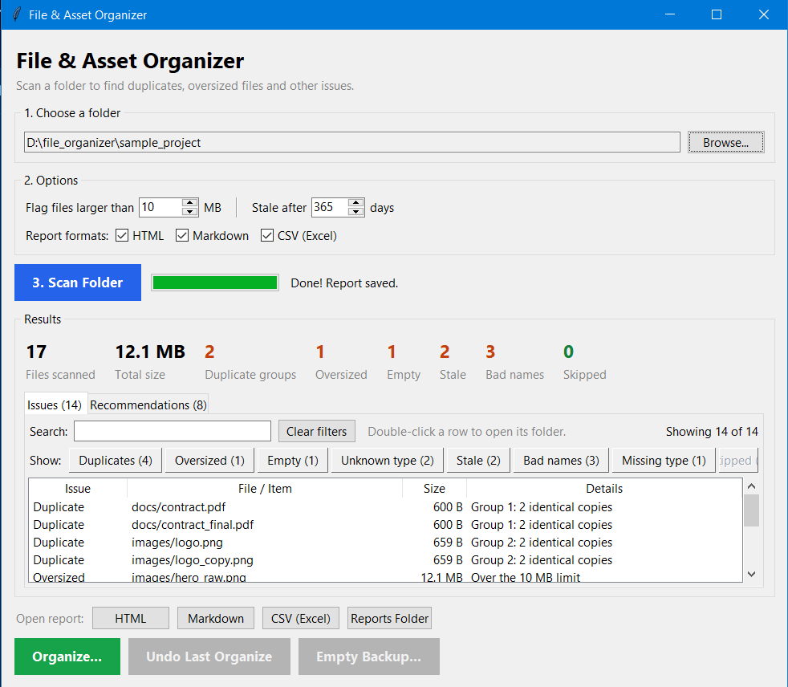
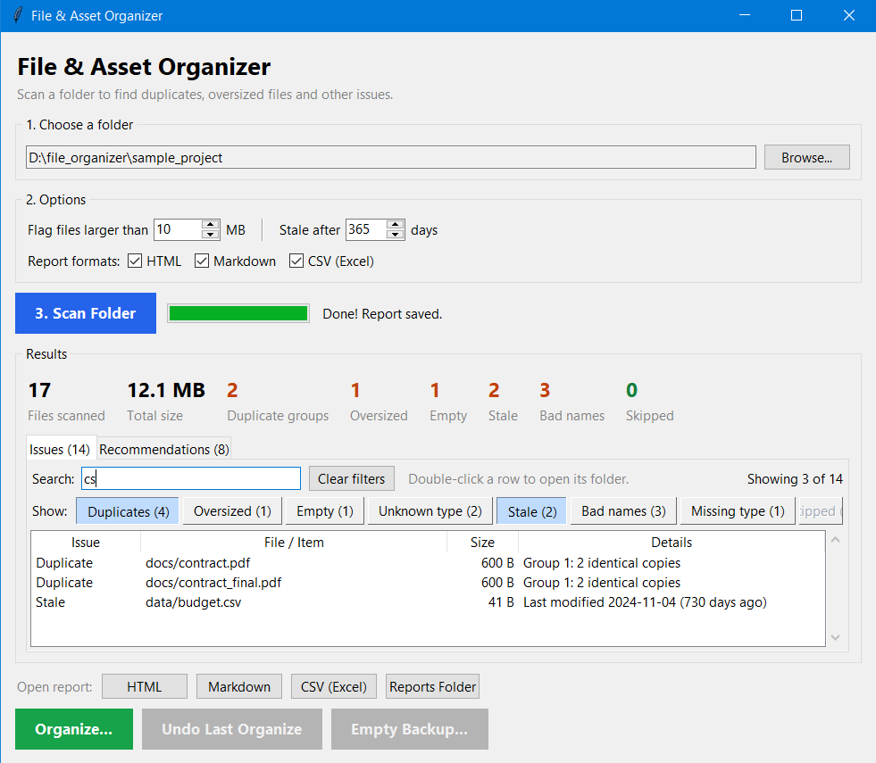
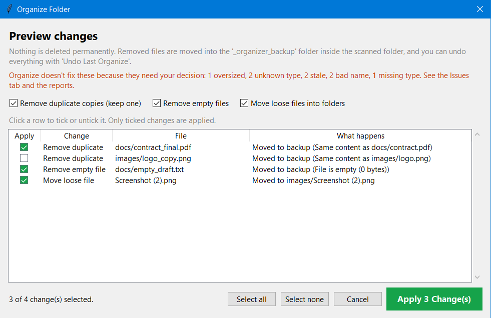
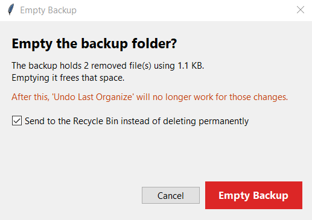

<h1 align="center">File & Asset Organizer + Report Generator</h1>

A Python script that scans a project folder, categorizes every file, flags potential
issues, and generates a clean Markdown and/or HTML report with summary stats and
recommendations.

<p align="center">
  <a href="docs/demo.mp4">
    
  </a>
</p>

<p align="center">
  
</p>

<p align="center">
  <a href="docs/demo.mp4">Watch the full video</a>
</p>

**Don't want to install Python?** Download `FileOrganizer.exe` from the
[latest release](https://github.com/GreatEpee/file_organizer/releases/latest) and double-click it.

## Live Demo

[View the sample report](https://greatepee.github.io/file_organizer/) (generated from the sample folder in this repo)

<p align="center">
  <a href="https://greatepee.github.io/file_organizer/">
    
  </a>
  <br>
  <sub>The HTML report: summary cards, a table per category and every issue listed. Light and dark mode are supported.</sub>
</p>

## Features

- **Categorizes files** into Images, PDFs, Documents, Spreadsheets, Presentations,
  Audio, Video, Archives, Code, Fonts, and Other.
- **Flags issues:**
  - Duplicate files (detected by content using SHA-256, not just by name)
  - Oversized files (default limit 10 MB, configurable)
  - Empty files
  - Files with unknown or missing extensions
  - Missing common asset types (Images, PDFs, Documents, Spreadsheets, Presentations)
  - Loose files sitting in the root folder
  - Unreadable files and folders (no permission, locked, broken links), listed in a
    "Skipped Files" section instead of being silently ignored
  - Stale files that haven't been modified in a long time (default 365 days, configurable)
  - Confusing file names: copies (`logo_copy.png`, `Report (2).pdf`), messy versions
    (`final_FINAL_v2.docx`), leftover temporary files (`~$report.docx`, `.bak`), extra
    spaces and very long names
- **Search and filters** in the desktop app: narrow the issues by type or search text, sort
  any column, and open a file's folder with a double-click. Built for large folders.
- **Generates reports** in Markdown, HTML (supports light and dark mode) and CSV.
  The CSV has one row per file with all its issues, ready to sort and filter in Excel.
- **Organize mode** that fixes problems for you: removes duplicate copies, removes empty
  files and moves loose files into folders. It shows a preview with a tick box on every
  change, never deletes anything permanently, and can undo everything.
- **Desktop app** with buttons, a results table and one-click report opening,
  which can be packaged as a double-click `.exe`.
- No external libraries needed. Uses only the Python standard library.

## Requirements

- Python 3.8 or newer

## Project Structure

```
file-organizer/
├── organizer.py              # scanning, analysis and report logic (command line)
├── organize.py               # organize mode: plan, apply and undo fixes
├── issues.py                 # rows, search, filters and sorting for the Issues table
├── app.py                    # desktop app (window with buttons)
├── tests/
│   ├── test_organizer.py     # tests for scanning, checks and reports
│   ├── test_organize.py      # tests for organize mode, undo and the backup
│   └── test_issues.py        # tests for the search, filters and sorting
├── docs/                     # GitHub Pages report, demo video and screenshots
│   └── screenshots/
├── pytest.ini                # pytest settings
├── requirements-dev.txt      # tools needed for development (pytest)
├── create_sample_folder.py   # builds a test folder with mixed files
├── README.md
├── reports/                  # generated reports go here
└── sample_project/           # test folder, created by create_sample_folder.py
```

## How to Run

First, create the sample test folder (optional, but useful for testing):
```bash
python create_sample_folder.py
```
This always saves `sample_project/` inside the project folder, next to the script,
no matter which directory your terminal is in. Running it again deletes the old
`sample_project/` and builds a fresh one, so test results stay the same.

### Option 1: Desktop app (easiest)
```bash
python app.py
```
1. Click **Browse...** and select the folder to scan.
2. Optionally change the size limit, the stale limit or the report formats.
3. Click **Scan Folder**. The results appear in the window, with an
   **Issues** tab and a **Recommendations** tab.
4. Use the **Open report** buttons (HTML, Markdown, CSV or the reports folder).
5. Use **Organize...**, **Undo Last Organize** and **Empty Backup...** to fix the problems
   (see [Organize Mode](#organize-mode)).

<p align="center">
  <a href="docs/screenshots/01-scan.png">
    
  </a>
  <br>
  <sub>The desktop app after scanning the sample folder: summary numbers, the issues table and the recommendations.</sub>
</p>

### Option 2: Interactive command line (pick folders with a window)
```bash
python organizer.py
```
1. A folder picker window opens. Select the folder you want to scan.
2. The report is generated in the `reports/` folder.
3. You are asked `Scan another folder? (y/n)`. Type `y` to pick another folder,
   or `n` to quit.

If no window can open, the script asks you to type the folder path instead.

### Option 3: Command line (scan one folder directly)
```bash
python organizer.py sample_project
python organizer.py "D:\MyProject"
```

Reports are saved as `reports/report_<folder name>.md`, `.html` and `.csv`, so
scanning several folders never overwrites an earlier report.

> On Windows, use `py` instead of `python` if `python` is not recognized.

## Search and Filters

After a scan, the **Issues** tab lists one row per file per problem, so you can find the
exact files even in very large folders.

<p align="center">
  <a href="docs/screenshots/02-filters.png">
    
  </a>
  <br>
  <sub>Filtering to duplicate and stale files, with a search typed in.</sub>
</p>

- **A filter button for every check**, with its count: Duplicates, Oversized, Empty, Unknown
  type, Stale, Bad names, Missing type and Skipped. Click one or several. A button with 0 is
  grayed out, and **Clear filters** resets everything.
- **Search** by file name, folder or detail. Every word you type must match, and upper or
  lower case doesn't matter (for example `logo identical`).
- **Click a number** in the summary row (such as Stale) to jump straight to those files.
- **Click a column heading** to sort. Click again to reverse. The first click on **Size**
  shows the biggest files first.
- **Double-click a row** to open its folder with the file highlighted. Right-click for
  **Show in folder** or **Copy path**.
- Very large lists show the first 5,000 rows. Use the filters to narrow them down.

## Organize Mode

Organize mode fixes three kinds of problems:

| Fix | What happens |
|---|---|
| Remove duplicate copies | Keeps one copy (the one with the cleanest name and shortest path) and moves the others to the backup folder |
| Remove empty files | Moves 0-byte files to the backup folder |
| Move loose files | Moves images, documents, spreadsheets and similar files from the root folder into `images/`, `docs/`, `data/` and so on |

**Safety rules**
- **Nothing is deleted permanently.** Removed files are moved into an `_organizer_backup`
  folder inside the scanned folder. Delete that folder yourself once you're happy.
- **Preview first.** Every change is listed before anything happens, and you must confirm.
- **Checked again right before acting.** If a file was edited, deleted or changed after the
  scan, that change is skipped.
- **Never overwrites.** If the destination already exists, `_1`, `_2` ... is added to the name.
- **Project files stay put.** `README`, `LICENSE`, `CHANGELOG` and similar files are never moved.
- **Undo** puts every file back where it was. Each organize can be undone in turn, newest first.

**In the desktop app:** scan a folder, click **Organize...**, choose the fixes, check the
preview and click **Apply**. Use **Undo Last Organize** to put everything back.
The preview lists every change with a tick box. Untick anything you don't want,
and only the ticked changes are applied. Issues that need a human decision (oversized,
stale, bad names, unknown types) are listed but never changed automatically.

<p align="center">
  <a href="docs/screenshots/03-organize.png">
    
  </a>
  <br>
  <sub>The organize preview: every change has a tick box, and one has been unticked.</sub>
</p>

**On the command line:**
```bash
python organizer.py sample_project --organize   # preview, then asks before applying
python organizer.py sample_project --undo       # undo the last organize
```

### Emptying the backup

Removed files stay in `_organizer_backup` until you empty it. Emptying it frees the disk
space, but **undo is no longer possible** for those changes.

- **Desktop app:** click **Empty Backup...**. It shows how much space will be freed and
  offers to send the backup to the Recycle Bin (Windows) instead of deleting it for good.
- **Command line:**
  ```bash
  python organizer.py sample_project --clean-backup                 # asks first, then deletes
  python organizer.py sample_project --clean-backup --recycle-bin   # Windows: use the Recycle Bin
  ```

<p align="center">
  <a href="docs/screenshots/04-backup.png">
    
  </a>
  <br>
  <sub>The Empty Backup window explains what will happen before anything is removed.</sub>
</p>

## CSV Columns

| Column | Meaning |
|---|---|
| `path` | Location inside the scanned folder |
| `name`, `extension`, `category` | File name, its extension and its category |
| `size_bytes` | Size as a plain number (use this column to sort by size) |
| `size` | Size in readable form, like `11.4 MB` |
| `last_modified` | Date and time the file was last changed |
| `duplicate_group` | Files with the same number are identical copies |
| `issues` | Every problem found for the file, separated by `;` (empty = no problems) |

Files and folders that couldn't be read also get a row, with `Skipped:` and the reason
in the `issues` column.

## Building the .exe (Windows)

Turn the desktop app into a program anyone can double-click, without installing Python:
```bash
python -m pip install pyinstaller
python -m PyInstaller --onefile --windowed --name FileOrganizer app.py
```
The program is created at `dist/FileOrganizer.exe`. Reports are saved in a
`reports` folder next to the `.exe`.

- `--onefile` packs everything into a single `.exe`
- `--windowed` hides the black terminal window

Windows may show a "Windows protected your PC" warning because the program isn't
signed. Click **More info → Run anyway**.

## Command-Line Options

| Option | Description | Default |
|---|---|---|
| `folder` | Folder to scan. Leave it out for interactive mode | — |
| `-f`, `--format` | `md`, `html`, `csv`, `both` (md + html) or `all` | `both` |
| `-o`, `--output` | Custom output file name without extension | `reports/report_<folder>` |
| `--max-size` | Size limit in MB for the oversized check | `10` |
| `--stale-days` | Flag files not modified for this many days | `365` |
| `--organize` | Preview and apply fixes (asks before changing anything) | — |
| `--undo` | Undo the last organize on the folder | — |
| `--clean-backup` | Empty the backup folder left by organize mode | — |
| `--recycle-bin` | With `--clean-backup`: send it to the Recycle Bin (Windows only) | — |

Example:
```bash
python organizer.py sample_project --format html --max-size 5
```

## What the Sample Folder Tests

Every sample file is a real, valid file (images, PDF, Word, Excel, zip), so they all
open normally in their usual apps.

To test, run `python organizer.py` and select the `sample_project` folder in the
picker window (or run `python organizer.py sample_project`).

| Test case | File(s) |
|---|---|
| Duplicates | `logo.png` / `logo_copy.png`, `contract.pdf` / `contract_final.pdf` |
| Oversized file | `images/hero_raw.png` (about 11.5 MB) |
| Empty file | `docs/empty_draft.txt` |
| Unknown types | `misc/LICENSE`, `misc/export.dat` |
| Missing asset type | No presentations included |
| Loose root file | `Screenshot (2).png` |
| Stale files | `data/budget.csv` (2 years old), `misc/old_assets.zip` (3 years old) |
| Bad file names | `images/logo_copy.png`, `Screenshot (2).png`, `docs/proposal_final_FINAL_v2.docx` |

## Running the Tests

The project has automated tests that check the scanning, duplicate detection, size
checks, skipped files, report generation, organize mode with undo, the backup, and the
search, filters and sorting.

```bash
python -m pip install -r requirements-dev.txt
python -m pytest
```
All tests should pass. Add `-v` to see each test by name.

> One test (the symlink safety check) is skipped on Windows unless Developer Mode is turned
> on, because Windows only lets some accounts create symlinks. That is expected.

## Customizing

Edit the configuration section at the top of `organizer.py`:
- `CATEGORIES` to add file extensions or new categories
- `EXPECTED_CATEGORIES` to change which asset types are checked as "missing"
- `DEFAULT_STALE_DAYS`, `MAX_NAME_LENGTH` and `VERSION_WORDS` to tune the stale and naming checks
- `IGNORE_DIRS` / `IGNORE_FILES` to skip folders like `.git` or `node_modules`